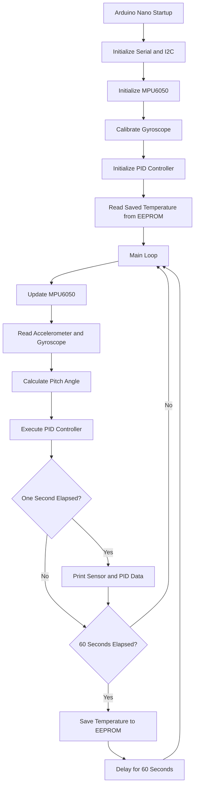

# Arduino Nano IMU-Based PID Control System with EEPROM

## 📌 Project Overview

This project is an embedded systems experiment built around an **Arduino Nano, MPU6050 IMU, PID controller, and EEPROM**.

The system reads motion data from the MPU6050, calculates the aircraft's pitch angle using accelerometer measurements, processes the angle through a PID controller, and displays sensor readings and controller values through the Serial Monitor.

It also stores the MPU6050 temperature in EEPROM so that the saved value can be retrieved after restarting the board.

The project is designed as a small-scale, toy-aircraft-inspired experiment for learning about **embedded C++, sensor interfacing, feedback control, non-volatile memory, and real-time programming concepts**.

> **Important:** This is a monitoring and control-algorithm prototype. The current implementation does not control motors, servos, or an actual aircraft.

## ✨ Features

- **IMU interfacing:** Reads accelerometer, gyroscope, and temperature data from the MPU6050.
- **Pitch angle calculation:** Estimates pitch from accelerometer measurements using `atan2()`.
- **PID control:** Calculates a controller output based on the measured angle and desired setpoint.
- **Serial monitoring:** Displays sensor readings, angles, PID values, error, and estimated PID execution frequency.
- **EEPROM storage:** Saves temperature data to non-volatile memory and retrieves the last saved value at startup.
- **Time-based execution:** Uses `millis()` to schedule periodic Serial output and temperature storage.
- **Gyroscope calibration:** Uses the MPU6050 library's gyro offset calibration during initialization.

## 🧰 Hardware Requirements

| Component | Purpose |
|---|---|
| Arduino Nano | Main microcontroller |
| MPU6050 module | Accelerometer, gyroscope, and temperature sensor |
| Breadboard | Prototyping |
| Jumper wires | Electrical connections |
| USB cable | Programming and Serial communication |
| Computer | Arduino IDE and Serial Monitor |

## 🔌 Pin Connections

The following connections assume a standard Arduino Nano using the ATmega328P and an MPU6050 breakout module.

| MPU6050 pin | Arduino Nano pin | Function |
|---|---|---|
| VCC | 3.3V or 5V, according to module specifications | Power supply |
| GND | GND | Common ground |
| SDA | A4 | I²C data |
| SCL | A5 | I²C clock |
| INT | Not connected | Interrupt output not used |

**Note:** Check your particular MPU6050 breakout board's voltage specifications before connecting VCC. Some boards support 5V input, while bare sensors and certain modules require 3.3V.

No motor, servo, or actuator pins are used in the current version.

## 🏗️ System Architecture

The firmware follows a sensor–controller–monitoring architecture.



### Software architecture

1. **Sensor layer:** Communicates with the MPU6050 over I²C and obtains accelerometer, gyroscope, and temperature readings.
2. **Measurement layer:** Calculates the pitch angle from the accelerometer axes.
3. **Control layer:** Uses the PID library to calculate the control output.
4. **Monitoring layer:** Reports sensor measurements, controller values, and execution statistics over Serial.
5. **Storage layer:** Reads and writes temperature values using EEPROM.
6. **Timing layer:** Uses `millis()` to track periodic operations.

## ⚙️ How the System Works

### 1. Initialization

Inside `setup()`, the firmware:

- Starts Serial communication at 9600 baud.
- Initializes the I²C interface using `Wire.begin()`.
- Initializes the MPU6050 and calibrates its gyroscope.
- Enables the PID controller in automatic mode.
- Sets the PID output limits to `-100` and `100`.
- Sets the PID sample time to 20 milliseconds.
- Reads the previously stored temperature from EEPROM address `0`.

### 2. IMU data acquisition

The MPU6050 provides three-axis accelerometer and gyroscope measurements.

- `Ax`, `Ay`, `Az`: Accelerometer measurements.
- `Gx`, `Gy`, `Gz`: Gyroscope measurements.

These values describe the sensor's motion and orientation. The accelerometer can estimate orientation relative to gravity when the sensor is sufficiently stationary, while the gyroscope measures angular velocity.

### 3. Pitch angle calculation

The measured pitch angle is calculated using:

```cpp
Input = atan2(-Ax, sqrt(Ay * Ay + Az * Az)) * 180.0 / PI;
```

This converts the accelerometer measurements into an angle in degrees.

The result is assigned to `Input`, which is the measurement used by the PID controller.

**Limitation:** This calculation is an accelerometer-based estimate. Acceleration caused by movement or vibration can affect the result. A more advanced implementation could use filtered accelerometer and gyroscope data or a sensor-fusion algorithm.

### 4. PID control

The PID controller is initialized with:

```cpp
double Input = 0;
double Setpoint = 0;
double Output = 0;

double Kp = 2.0;
double Ki = 0.0;
double Kd = 0.0;

PID myPID(&Input, &Output, &Setpoint, Kp, Ki, Kd, DIRECT);
```

The controller compares the measured pitch angle with the desired setpoint.

The control error is:

\[
e(t) = \text{Setpoint} - \text{Input}
\]

The general PID equation is:

\[
u(t)=K_p e(t)+K_i\int e(t)\,dt+K_d\frac{de(t)}{dt}
\]

In the current configuration:

- **Kp = 2.0:** Proportional response to the angle error.
- **Ki = 0.0:** Integral action is disabled.
- **Kd = 0.0:** Derivative action is disabled.
- **Setpoint = 0:** The desired pitch angle is zero degrees.
- **Output limits:** The calculated output is restricted to the range from -100 to +100.

Because the integral and derivative gains are zero, the controller currently behaves as a proportional controller.

The output is calculated and printed to Serial. It is not connected to a physical actuator.

### 5. EEPROM data storage

The firmware uses the Arduino EEPROM library to preserve a temperature measurement.

At startup:

```cpp
EEPROM.get(0, savedTemp);
```

This retrieves the value stored at EEPROM address `0`.

During operation:

```cpp
temperature = mpu6050.getTemp();
EEPROM.put(0, temperature);
```

This stores the latest temperature reading in non-volatile memory.

Unlike ordinary RAM, EEPROM retains its contents when the Arduino loses power. This makes it useful for storing configuration values, calibration parameters, and selected measurements.

**Important:** The current code does not verify whether EEPROM contains a valid temperature on the first startup. An uninitialized or previously used EEPROM location may not contain a meaningful temperature.

### 6. Timing and execution frequency

The firmware uses `millis()` to measure elapsed time without using a delay in the main monitoring interval.

For example:

```cpp
if (currentMillis - timer >= 1000) {
    // Print monitoring data
    timer = currentMillis;
}
```

This schedules the monitoring output approximately once per second.

The PID sample time is configured as:

```cpp
myPID.SetSampleTime(20);
```

This requests a PID computation interval of 20 milliseconds, equivalent to a nominal rate of 50 Hz when the main loop is running continuously and the PID computation succeeds.

The `pidCount` variable counts successful calls to `myPID.Compute()`. The program reports the number counted in the previous one-second interval as `System Speed`.

This value is an estimate of the PID computation rate, not a measurement of the processor clock speed.

**Current timing limitation:** After storing temperature, the firmware executes `delay(60000)`. This blocks the main loop for approximately 60 seconds, preventing normal sensor updates and PID computations during that period. Consequently, the system does not provide continuous real-time control in its current implementation.

## 🖥️ Serial Monitor Output

Set the Arduino IDE Serial Monitor to **9600 baud**.

The firmware reports:

- MPU6050 temperature.
- Accelerometer values on all three axes.
- Gyroscope values on all three axes.
- Accelerometer-derived angles.
- Gyroscope-derived angles.
- MPU6050 library angle estimates.
- PID input, setpoint, and output.
- Calculated error.
- PID computation count per monitoring interval.
- Temperature values written to EEPROM.

Example output format:

```text
temp : 25.00
accX : 0.10    accY : 0.05    accZ : 0.98
gyroX : 0.12   gyroY : -0.08  gyroZ : 0.02
accAngleX : ...
accAngleY : ...
gyroAngleX : ...
angleX : ...
Input: -5.20 Setpoint: 0.00 Output: 10.40
 Error: 5.20
System Speed: 50.00 Hz
Stored Temperature: 25.00
```

The numbers above are illustrative only; actual measurements depend on the sensor, its orientation, and operating conditions.

## 📚 Libraries Used

Install these libraries through the Arduino IDE Library Manager, where available:

| Library | Purpose |
|---|---|
| `PID_v1.h` | PID controller implementation |
| `Wire.h` | I²C communication |
| `EEPROM.h` | Non-volatile data storage |
| `MPU6050_tockn.h` | MPU6050 sensor interface and angle calculations |

## 🚀 Getting Started

1. Connect the MPU6050 to the Arduino Nano using the pin table above.
2. Install the required Arduino libraries.
3. Open the `.ino` source file in Arduino IDE.
4. Select the correct Arduino Nano board and processor option for your hardware.
5. Select the appropriate serial port.
6. Upload the firmware.
7. Open Serial Monitor at 9600 baud.
8. Observe the sensor readings, PID calculations, and stored temperature.

During gyroscope calibration, keep the IMU stationary for reliable offset calibration.

## 📂 Suggested Repository Structure

```text
Arduino-Nano-IMU-PID/
├── Arduino-Nano-IMU-PID.ino
├── README.md
└── LICENSE
```

The `.ino` file contains the complete firmware. The README documents the hardware, architecture, and software behavior.

## 🎯 Learning Objectives

This project provides practical experience with:

- Embedded C++ programming.
- I²C peripheral communication.
- IMU interfacing and orientation estimation.
- Feedback-control fundamentals.
- PID library configuration and tuning.
- EEPROM read/write operations.
- Periodic task scheduling with `millis()`.
- Serial debugging and performance monitoring.
- Understanding the limitations of blocking delays in embedded applications.

## 🔮 Future Improvements

- Replace the 60-second blocking delay with non-blocking `millis()` scheduling.
- Add EEPROM validity checks and a safe initialization value.
- Implement accelerometer/gyroscope sensor fusion for improved angle estimation.
- Experiment with PID tuning and compare proportional, PI, and PID behavior.
- Log sensor and controller data for offline analysis.
- Add an actuator interface and safety limits if closed-loop physical control is later required.
- Separate sensor acquisition, control, monitoring, and storage into functions for improved maintainability.

## 📌 Project Status

**Current stage:** IMU data acquisition, pitch estimation, PID computation, Serial monitoring, and EEPROM temperature storage.

**Control output:** Calculated and monitored through Serial; no actuator is currently connected.

**Main focus:** Learning embedded systems fundamentals through a compact Arduino Nano-based IMU and PID experiment.
